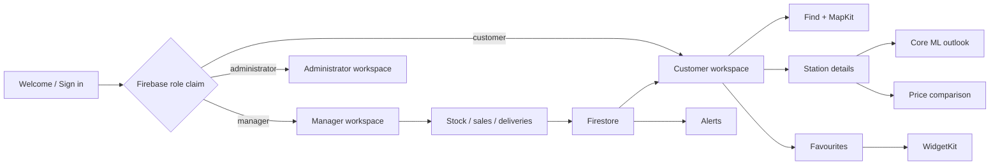

# FuelSmart LK

FuelSmart LK is a native iOS fuel-station discovery and inventory application for Sri Lanka. It gives customers a searchable map, reported stock and price information, same-grade price comparison, favourites, alerts and an on-device fuel outlook. Separate manager and administrator workspaces support operational records and role-controlled management.

> Station availability and forecasts are informational. Demonstration records are labelled as demo data and should be verified before travel.

## UI tour

| Area | Customer UI | Manager / administrator UI |
| --- | --- | --- |
| Access | Welcome, account creation, email verification, password setup/reset, Sign in with Apple and Face ID opt-in | Firebase-authenticated, claim-based role routing |
| Home | Favourite station summary, current reports and fuel outlook | Assigned-station stock, activity and analytics overview |
| Find | Text search, fuel/availability filters, list and MapKit views | Station details and operational context |
| Station | Stock/capacity, price, freshness/source, directions and Core ML outlook | Stock, sale, delivery and price management |
| Personal | Favourites, comparison, notification preferences and profile | Manager profile or administrator operations |
| Outside app | WidgetKit favourite-station widget and local notifications | ActivityKit fuel-journey Live Activity |

The SwiftUI previews in the source cover standard, dark and accessibility text configurations for the principal screens. Open the Canvas beside files such as `CustomerWorkspaceView.swift`, `StationMapView.swift`, `StationDetailsView.swift`, `FuelComparisonView.swift`, `ManagerWorkspaceView.swift` and `AdministratorWorkspaceView.swift` to inspect the UI without signing in.

## Main functionality

- Customer email/password registration, email verification, password creation and recovery
- Sign in with Apple and Firebase Authentication session restoration
- Customer, manager and administrator authorization using trusted Firebase role claims
- Face ID through LocalAuthentication with credentials protected by Keychain
- Firestore-backed stations, stock reports, fuel prices, transactions, profiles and alert events
- Search and filters by fuel grade, reported availability and location
- MapKit station pins, Core Location user location and Apple Maps directions
- Same-fuel price comparison with report source, time and stale-state handling
- Account-scoped favourites and WidgetKit snapshot sharing through an App Group
- Core ML demand prediction from current stock and confirmed recent sales, with a transparent local fallback
- UserNotifications-based local alerts filtered by favourites and fuel preferences
- Manager stock, sales, delivery receipt, pricing, notifications and analytics workflows
- Vision/VisionKit-assisted delivery receipt capture with user review
- Swift Charts manager analytics
- ActivityKit fuel-journey Live Activity

## Apple frameworks and services

| Technology | Purpose |
| --- | --- |
| SwiftUI + Observation | Adaptive UI, navigation and application state |
| MapKit + Core Location | Station map, user position and directions |
| Core ML | On-device fuel-demand inference using the bundled `FuelDemandRegressor.mlmodel` |
| WidgetKit + App Groups | Favourite-station Home Screen widget |
| ActivityKit | Time-limited fuel-journey Live Activity |
| LocalAuthentication + Keychain | Face ID opt-in and protected credential retrieval |
| UserNotifications | Local price and restock notifications |
| Vision / VisionKit | Delivery receipt text capture and parsing |
| Charts | Manager sales and delivery visualisation |
| AuthenticationServices | Sign in with Apple |
| Firebase Authentication | Identity, email verification and account recovery |
| Cloud Firestore | Real-time application and operational data |

## Architecture and data flow

The project uses SwiftUI feature views backed by small observable stores and service boundaries. Firebase Authentication establishes identity; server-issued role claims choose the permitted workspace. Firestore stores users, stations, reports and confirmed transactions. Prediction features are constructed locally and sent only to the bundled Core ML model—no prediction data is sent to a cloud inference service.

When input data is stale or insufficient, the UI does not invent a forecast. Core ML output is bounded against observed demand, and the app identifies whether the Core ML engine or local baseline produced the result.

## Requirements

- macOS with the compatible Xcode release and iOS 26.5 SDK or later
- An Apple development team for physical-device installation
- A Firebase iOS app whose bundle identifier matches `thisara.FuelLanka`
- A valid `GoogleService-Info.plist` obtained from the Firebase console
- Camera, location, notification and biometric permissions for their respective features

## Configuration

1. Clone the repository and open `FuelLanka.xcodeproj`.
2. Copy `GoogleService-Info.example.plist` to `GoogleService-Info.plist` and replace every placeholder with values downloaded from your Firebase iOS app. Never commit the real file.
3. Select your development team for both `FuelLanka` and `FuelLankaWidgetsExtension`.
4. Ensure the App Group `group.thisara.FuelLanka` is available to both targets.
5. Enable Email/Password and Apple providers in Firebase Authentication as needed.
6. Deploy `firestore.rules` to the intended Firebase project.
7. Select the `FuelLanka` scheme and run on an iOS 26.5+ simulator or device.

The optional `scripts/seed_demo_firestore.mjs` script creates clearly labelled demonstration stations, reports, transactions and alerts. It requires a separately supplied Firebase CLI access token and must never be committed with credentials.

## Marker access

The backend project identifier is `fuelsmart-lk`. Marker accounts are available for the customer, manager and administrator roles. To avoid committing passwords, account passwords and any temporary Firebase read-only invitation must be supplied privately through the approved LMS marker notes or directly to the lecturer.

| Role | Account identifier |
| --- | --- |
| Customer | `customer@fuelsmart-lk.app` |
| Manager | `manager@fuelsmart-lk.app` |
| Administrator | `admin@fuelsmart-lk.app` |

Do not place account passwords, Firebase CLI tokens, service-account JSON or the production `GoogleService-Info.plist` in Git.

## Testing

The project contains 51 Swift Testing unit tests and 5 XCUIAutomation tests (56 enabled tests total). Coverage includes authentication state and role routing, registration/sign-in validation, prediction eligibility and Core ML inference, stock/capacity rules, price validation, manager analytics, receipt parsing, Apple nonce generation and station coordinate guards.

Run tests in Xcode with **Product → Test** (`⌘U`). A build-for-testing validation was completed successfully on 24 October 2026. Physical-device checks remain appropriate for Face ID, camera capture, WidgetKit, Live Activities and notification presentation.

## Known limitations

- Seeded Firestore data is demonstration data, not verified real-time fuel availability.
- Current station alerts are observed from Firestore and scheduled as local notifications. Guaranteed delivery while the app is terminated requires APNs/FCM production configuration.
- WidgetKit controls refresh timing; widget data is not continuously refreshed.
- Forecasts are estimates based on confirmed recent sales and current reported stock, not guarantees.

## Repository and submission

Repository: <https://github.com/thisara011/FuelLanka-IOS_app>

The assessment report must link to the immutable final commit:

`https://github.com/thisara011/FuelLanka-IOS_app/commit/<FINAL_COMMIT_SHA>`

Replace `<FINAL_COMMIT_SHA>` only after all source, tests, documentation and configuration examples have been committed. Commits made later may not be graded.

## Security

Please report security issues privately. Do not open a public issue containing credentials, Firebase tokens or customer information.
